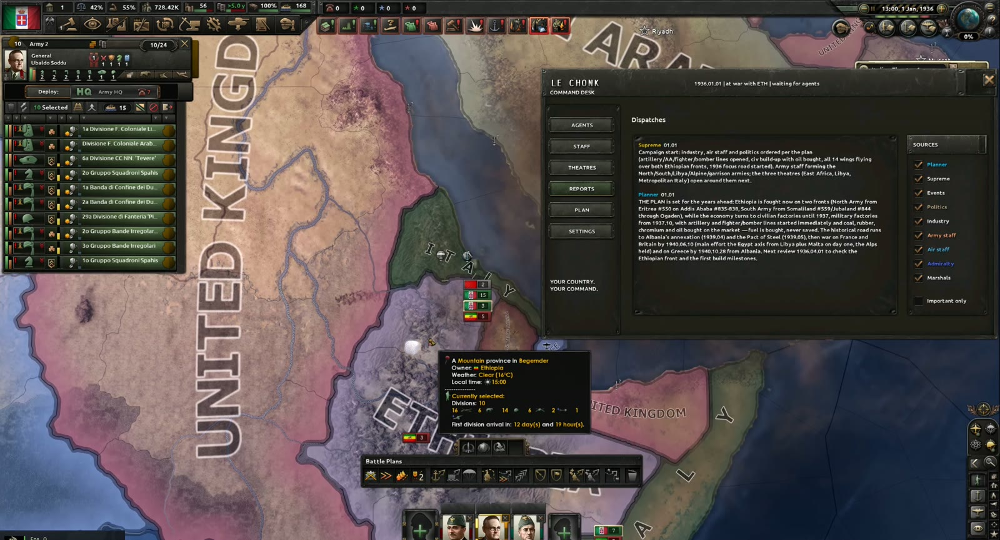
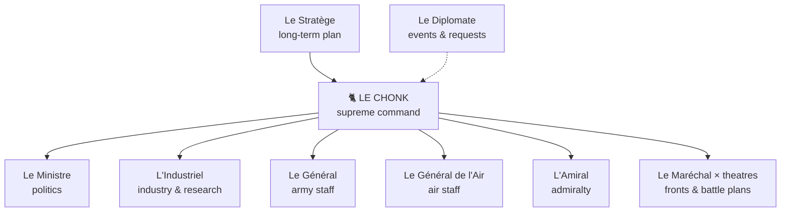
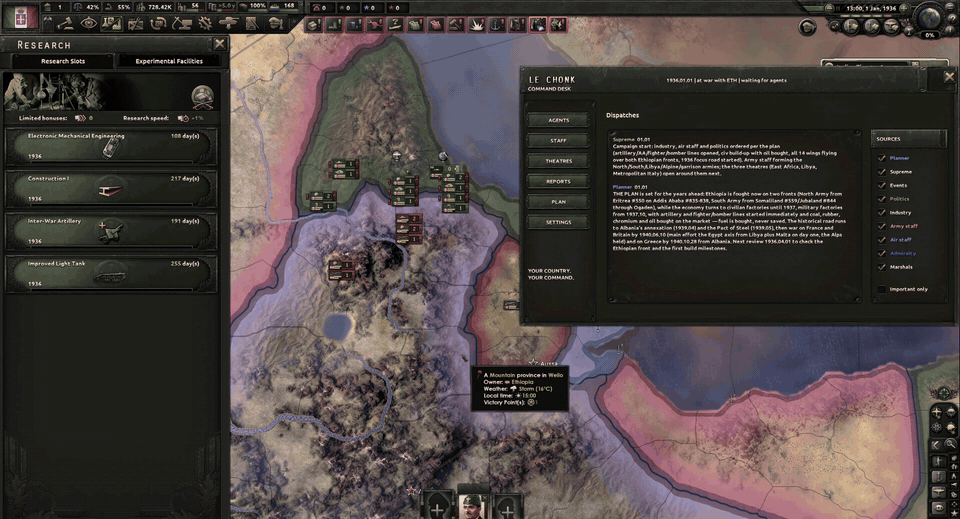

<div align="center">

# 🐈 Le Chonk

### Mistral Large 4 plays *Hearts of Iron IV* — with an entire war cabinet

[](docs/submission/POST.md)

[](https://docs.mistral.ai/)
[](#setup)
[](#setup)
[](requirements.txt)
[](LICENSE)

[](https://github.com/shefowl/le-chonk/releases/tag/v0.1.0)

**[▶ Watch the two-minute demo](https://github.com/shefowl/le-chonk/releases/tag/v0.1.0)** · **[Challenge write-up](docs/submission/POST.md)** · **[Setup](#setup)** · **[Runbook](docs/RUNBOOK.md)**

</div>

An entire nation, an entire general staff, and one very large cat in command. Le Chonk runs a HOI4 country through a cabinet of agents — planner, supreme command, politics, industry, army, air force, navy and a field marshal per theatre. The same model, **Mistral Large 4**, can fill every seat.

Run the whole country autonomously, or **play alongside it**: hand the navy, the air force or industry to the cabinet, keep the rest yourself, and take any branch back from a native in-game command desk.

## The war cabinet

| Seat | Role | Responsibilities |
|:--|:--|:--|
| **Le Stratège** | Planner | Long-term plan: economy, research, production, politics, force targets, future wars |
| **LE CHONK** 🐈 | Supreme command | Turns the plan into theatre objectives, force allocations and orders to ministries and staffs |
| **Le Diplomate** | Events & requests | Answers events and diplomatic requests between cabinet meetings |
| **Le Ministre** | Politics | Focuses, political power, laws, advisors, decisions, country mechanics |
| **L'Industriel** | Industry & research | Construction, research, production lines, trade, equipment |
| **Le Général** | Army staff | Armies and army groups, commanders, templates, recruitment, training |
| **Le Général de l'Air** | Air staff | Wings, airfields, missions: fighters, bombers, close air support |
| **L'Amiral** | Admiralty | Fleets, task forces, convoys, sea zones, landings |
| **Le Maréchal** | Field marshal, one per theatre | Reads its front, assigns army sectors, draws attacks and fallback lines |



## How it plays

Think of an enthusiastic human with fewer than 100 hours in HOI4, not a veteran with a perfect build. The harness supplies information and tools; it never swaps the model's strategy for a scripted one. Development campaigns (several models, not all of them Mistral Large 4):

<div align="center">

<br><sub>Italy, January 1936: the cabinet writes its plan, forms armies and draws battle plans against Ethiopia (2× speed).</sub>
</div>

| Campaign | Outcome |
|:--|:--|
| Germany, 1939 | Defeated Poland and France without much trouble |
| France, 1936, historical | Held the Belgian border and the Maginot Line for about three months, with no prescribed survival plan |
| UK, 1936, historical | Beat German and Italian naval forces, made progress in Africa, strong industry by 1940 |
| Japan, 1936, historical | Got stuck at Beiping — invading China turns out to require a plan |
| USSR, 1936, historical | So worried about Japan that it kept forces in the Far East while the German front collapsed |

**What the cabinet can touch:** focuses, laws, advisors, decisions, construction, research, production, trade, diplomacy, espionage, division templates and recruitment, army organisation, fronts and battle plans, naval missions, air wings and missions, logistics, supply and HQs.

The recording shows Italy's opening against Ethiopia: planning, focuses, industry, fronts and battle plans. It is edited and sped up 2×; it demonstrates an autonomous opening, not a completed war. You can also play alongside the cabinet: delegate the navy, air force or another branch and keep the rest under your control.

> [!NOTE]
> **Contest profile:** `--models lechonk` uses **Mistral Studio**, `https://api.mistral.ai/v1`, exact model **`mistral-large-4` for every role**. It does not use `mistral-large-latest` or OpenRouter. Other providers are available for development and BYOK.

> [!IMPORTANT]
> **Compatibility:** native Linux x86-64, single-player HOI4 **1.19.4.1**, ELF build ID `2265e6e7c1f527bf4b1f2c4b4ca3efd4371dc082`. This build was used for the live Italy demonstration. A version number alone is insufficient. The guard refuses a different executable. Multiplayer is not supported. **Windows support is coming soon**; Windows/Proton does not work with the current release.

## Setup

You need your own Steam copy of HOI4, a Linux desktop, Python 3.11+, Tkinter, binutils (`objdump`, `readelf`), and a working systemd user session with cgroup v2 memory control. Tested Python packages are pinned in `requirements.txt`. On Debian/Ubuntu, install system packages with `sudo apt install python3-venv python3-tk binutils` (package names differ on other distributions).

This repository includes the exact modified `bridge/` source, with its original MIT license. The bridge is versioned separately in the development workspace; the public tree embeds it directly, so no submodule setup is needed. Cloning upstream alone does not provide this harness or its required port. `SOURCE_MANIFEST.json` records the original development commits and file hashes of the exported snapshot.

```bash
git clone https://github.com/shefowl/le-chonk.git
cd le-chonk
python3 -m venv .venv
source .venv/bin/activate
python3 -m pip install -r requirements.txt
# Optional when Steam autodetection cannot find your native Linux game:
export HOI4_PATH="$HOME/.local/share/Steam/steamapps/common/Hearts of Iron IV"
export HOI4_DIR="$HOI4_PATH"  # GUI texture/font source
chmod +x tools/run_campaign.sh
python3 tools/bootstrap_bridge.py
python3 mod/build.py
python3 tools/install_mod.py
python3 tools/configure_model.py
```

Enable **Le Chonk control** in a launcher playset, without other gameplay mods, and restart the game after a UI rebuild. Game textures are generated locally from your installation; the public source archive contains no game binary or derived DDS assets. DLC changes the available mechanics; unsupported or absent mechanics should be reported by tools rather than assumed available. The exact final-run DLC/build list belongs with the recording results.

Reading/injecting into a same-user game process needs ptrace permission. Check `/proc/sys/kernel/yama/ptrace_scope`. If your distribution blocks it, a local temporary option is `sudo sysctl -w kernel.yama.ptrace_scope=0`; this relaxes same-user process inspection for the boot session. Restore the previous value afterward. Do not run the harness as root.

## Bring your own key

`python3 tools/configure_model.py` opens a separate masked setup window. Choose **mistral** (default Studio URL and `mistral-large-4`) or **custom** (API base URL, model ID, optional key for a local server). A custom endpoint must implement OpenAI-compatible streamed `/chat/completions` with tool calling and support the selected model's inputs. Remote endpoints require HTTPS; localhost HTTP is allowed. Keys are sent to the selected API provider.

Saving makes no API request. **Check model access** makes only `GET /models`. A custom server without this optional endpoint may still support chat; check its documentation. Settings → **API SETUP** opens the same window while the harness is connected. Before the first connection, use the standalone command above.

Settings are stored in ignored `config/llm.json`, atomically, with permissions `600`. Blank key retains a stored key only for the same provider and endpoint. Restart the harness to apply changes. Keys never enter game variables, saves, chat, or usage journals. Keep setup windows out of recordings.

For a file-only setup, copy `config/llm.example.json` to `config/llm.json`, `chmod 600 config/llm.json`, and edit it locally. `LECHONK_CONFIG` can select another private file. Alternatively, copy `.env.example` to `.env`, `chmod 600 .env`, and set `MISTRAL_API_KEY`. For Studio, a saved nonempty key takes priority over the environment key; a custom key is never reused for Studio. Examples and stop/resume procedures are in the [runbook](docs/RUNBOOK.md).

## Run

For a desktop start/stop window, run `python3 tools/launcher.py`, select **Mistral Large 4 (Mistral Studio)**, and open **API Setup** if needed. Disable **Resume campaign** for a new country/save; enable it only to continue the matching saved campaign. The launcher still uses the memory-limited campaign wrapper. The native in-game desk is a separate interface for controlling agents during play.

Load a single-player save **on pause**, then:

```bash
python3 tools/preflight.py --api --live --expect ITA
# Fresh Italy 1 January 1936, already at war with Ethiopia:
python3 tools/final_run.py --start --api --days 30
```

The final launcher archives previous campaign/chat/roster files, enables every role, selects speed 5 with emergency pauses, and starts through the required 6 GiB / zero-swap wrapper. It refuses the wrong country/date before any model call. It never loads a save or chooses military objectives for the model.

For another save or custom API:

```bash
tools/run_campaign.sh --models configured --days 30 --speed 4 --peace-speed 4 --history on --pause fires
```

CLI speeds are **zero-based (0–4)**; the in-game settings show **1–5**. `--history on` limits political choices to the historical course; it is optional outside the prepared demo. Alarms can pause for a new war, lost territory or an uncovered front. They are signals, not a guarantee of good strategic decisions. The opening planning/staff turns still pause while initial orders are prepared.

Stop with `kill -TERM $(pgrep -f '^(/[^ ]*/)?python3 -u -m harness[.]run')`, then let in-flight turns finish (up to about 200 seconds). Normal shutdown pauses the game and saves state. `--resume` continues the same campaign; use `--rewound` only after deliberately loading an older save from that campaign. Never carry a previous country's campaign file into a fresh run.

## How it works

Models receive current game state, maps, front coverage, losses, equipment, diplomacy and country mechanics. They choose actions through role-specific tools. A single Gateway worker serializes every game read/write/call; model requests may run in parallel. Commands use the game's own queue, with eligibility and readback checks in the implemented wrappers. Some older wrappers still have incomplete confirmation; see the [audit](docs/2026-10-29-final-audit.md).

The bridge reads process memory and invokes known native command functions. This is not mouse-only computer use. It does not add factories, units or resources with cheat commands. The harness supplies tools and briefings, schedules turns and handles alerts; models decide the plan, allocation and orders. HOI4's own battle-plan execution moves assigned divisions. Model mistakes, rejected/partial actions and losses remain part of the result.

The planner can consult the bundled, attributed wiki extracts and game files. Large 4 Preview currently rejects Studio builtin connectors. Optional general web search is an ordinary local tool using a SearXNG JSON endpoint (`LECHONK_SEARCH_URL`); the same selected model summarizes the retrieved snippets through Chat Completions. Without that endpoint, the tool explicitly reports unavailable and the wiki/game-file tools remain available. No other model is silently substituted.

## Checks and submission

```bash
python3 -m pip install -r requirements-dev.txt
python3 -m unittest discover -s tests
python3 tools/preview_gui.py mod/le_chonk shots/review
python3 tools/package_submission.py
```

A tiny paid API-only integration probe is available as `python3 tools/smoke_studio.py --run`; it checks one tool call without touching the game.

The full offline suite needs the installed game's GUI assets; Claude subscription adapter tests additionally use the dev dependency but make no model calls. **304 offline tests passed** before publication. Offline previews cannot prove native scroll/hover/input or an actual game outcome; the linked video is the live opening demonstration. Development campaigns used several models and are described separately in the write-up. Studio Large 4 rejects reasoning `none`; this client maps it to the minimum supported `low`.

- [Runbook and troubleshooting](docs/RUNBOOK.md)
- [Development and third-party attribution](docs/DEVELOPMENT.md)
- [Two-minute recording plan](docs/submission/VIDEO.md)
- [Discord submission draft/checklist](docs/submission/SUBMIT.md)

Code: MIT, with the bridge's original license retained. Wiki text keeps its own CC BY-SA attribution. HOI4 and its artwork belong to Paradox; this is an unofficial project.
